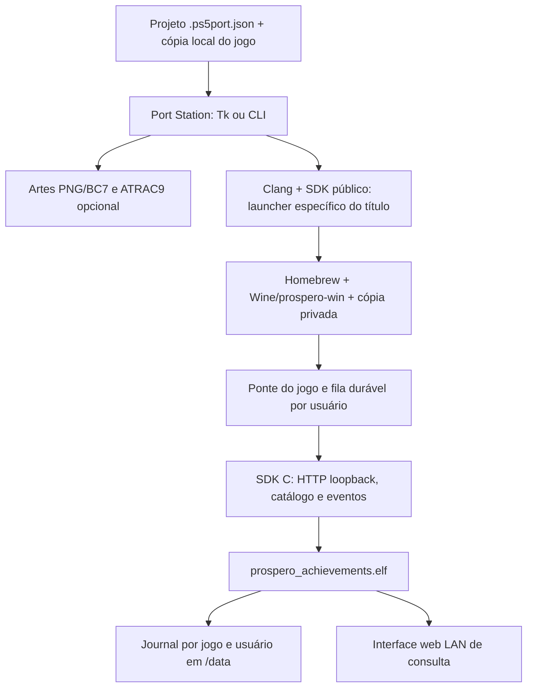

# Port Station

[Baixar a release](https://github.com/SuppaHackaD/Port_Station/releases/latest) · [Verificações](https://github.com/SuppaHackaD/Port_Station/actions)

Ferramenta aberta para empacotar uma **cópia local de um jogo Windows** como homebrew PS5, usando Wine/prospero-win. Interface Python/Tk, CLI, apresentação personalizável e conquistas independentes pelo **Prospero Achievements**.

Este projeto não é afiliado, patrocinado ou aprovado pela Sony, Valve, Kit9 Studio, Herbherth ou pelos desenvolvedores dos jogos citados. Marcas e jogos pertencem aos respectivos titulares.

**Não distribuímos executáveis, DLLs modificadas dos jogos, engines comerciais, mapas, diálogos, traduções completas, trilhas sonoras ou artes oficiais.** Os exemplos incluem metadados de compatibilidade e listas de conquistas; suas imagens são placeholders próprios com texto e formas geométricas, sem música. As pastas de jogos são fornecidas pelo usuário, localmente, e ficam fora do Git.

Compre os jogos e apoie seus criadores:

- [The Coffin of Andy and Leyley — Kit9 Studio](https://store.steampowered.com/app/2378900/).
- [Breath — Herbherth](https://store.steampowered.com/app/1475350/).

## Começar pela release

1. Windows x64; instale Python **3.13 x64 com Tcl/Tk**. Não é necessário instalar Unity para usar os binários desta release.
2. Extraia `Port_Station-0.2.2-windows-kit.zip` em uma pasta com espaço livre. O kit inclui os compiladores públicos, runtime, fontes correspondentes do projeto, SDK, encoder ATRAC9 e payload de conquistas. Os binários não devem ser adicionados ao Git; são assets da release.
3. Execute `Port_Station.cmd` e abra um exemplo em `port_studio/examples/`. Informe sua própria pasta de jogo. Os exemplos apontam inicialmente para `local-games/breath` e `local-games/tcoal`, que **não acompanham** o projeto.
4. Prepare sua cópia conforme [o guia dos jogos](docs/GAMES.md). No caso de Breath, isso instala a ponte própria em uma cópia privada; nenhum arquivo do jogo é distribuído com o patcher.
5. Configure título, Title ID exclusivo, imagens, lista de conquistas e platina. Compile para uma pasta nova fora do repositório. A saída contém os arquivos do seu jogo: **não publique essa saída**.
6. Copie sua pasta final para o local de homebrews do console e abra pelo loader compatível. A ferramenta não instala nem executa títulos automaticamente.

Teste real: firmware **13.60**, Relapse, PLDMGR 0.6.1 e ShadowMount+. Isso descreve o ambiente exercitado; não é promessa de suporte a qualquer firmware ou jogo Windows. O projeto não fornece firmware, chaves, exploit de desbloqueio ou SDK proprietário.

Para música personalizada, o encoder ATRAC9 próprio está no kit. A decodificação de MP3/WAV/etc. usa FFmpeg opcional: execute `python release_support/install-ffmpeg.py`. O download verificado vem diretamente do distribuidor, sob sua licença; o executável FFmpeg não é redistribuído por esta release. Sem música, essa etapa é dispensável.

## Arquitetura

O Windows continua executando através da camada Wine; a ferramenta não converte automaticamente a engine em uma engine PS5. O launcher nativo e seu helper são compilados para o Title ID escolhido. Um prefixo isolado recebe os arquivos privados no primeiro boot, com validação de tamanho/CRC. Reaberturas preservam saves; perfis e scripts próprios da ponte são sincronizados separadamente.

`runtime.lock.json` verifica SHA-256 dos insumos públicos. O recibo da build identifica fontes, jogo local, projeto e saída. O objetivo é um processo repetível com dependências fixadas, sem prometer resultados byte a byte idênticos entre caminhos e máquinas diferentes.

### Conquistas próprias

O payload é geral: cada jogo fornece catálogo, ícones e eventos reais. O SDK mantém a fila em disco quando o serviço está ausente e usa IDs estáveis para deduplicar reenvios. O backend persiste o estado por `game_id` e usuário e calcula a platina quando todas as conquistas regulares são obtidas. O popup é apresentado pelo cliente após a confirmação aceita.

Carregue `build/prospero-achievements/ps5/prospero_achievements.elf` com seu loader. A web fica em `http://IP_DO_CONSOLE:38765/`. Dados em `/data/prospero-achievements`; dados dos títulos em `/data/port-studio/<title_id>`. Escrita HTTP é restrita a loopback, sem Origin; a interface LAN é de consulta. Use em rede local confiável; não exponha a porta à Internet.

Não são troféus oficiais Sony. Não há sincronização PSN, NPWR, alteração do serviço de troféus ou registro nas listas oficiais do sistema.

Os exemplos trazem Breath com **11 conquistas + platina** e TCOAL com **20 + platina**. Listar conquistas não implementa suas condições: novos jogos precisam de integração `file-v1`, de uma API suportada ou de um adaptador novo. Preservar `game_id` compartilha a mesma entrada e progresso entre builds; Title ID e `game_id` têm funções distintas.

## Código e recompilação

- [Compilar frontend, ferramentas, SDK, backend e pontes](docs/BUILDING.md).
- [Preparar as cópias locais de Breath e TCOAL](docs/GAMES.md).
- [Publicar o repositório e os arquivos de release](docs/RELEASING.md).
- [Créditos, versões, licenças e fontes de terceiros](THIRD_PARTY.md).
- [Contrato HTTP](sdk/prospero-achievements/docs/PROTOCOL.md) e [SDK](sdk/prospero-achievements/README.md).

O frontend e os integradores próprios são GPL-3.0-or-later. As partes de terceiros mantêm suas licenças originais; consulte [LICENSE](LICENSE), [NOTICE](NOTICE.md) e os avisos por componente. A licença do projeto não relicencia jogos, marcas ou conteúdo que você fornecer.

## Estado e limites

TCOAL gerado pelo Studio foi validado em console: carregamento Canvas, fonte Faustina, textos/idioma, imagem/som/controle, ícone/fundo/música personalizada, saída por Options + clique do touchpad e fechamento pelo botão PS. Warden Wins foi obtida manualmente, confirmada pelo backend e preservada ao reabrir, sem duplicar popup. Breath e sua ponte também foram exercitados no console. Os placeholders desta publicação substituem apenas a apresentação e os ícones do catálogo; essa nova combinação precisa de seu teste local.

Há testes Python, wrappers JavaScript e testes host do serviço real. Não há validação de toda a campanha ou de todas as conquistas pelo simples sucesso de uma delas. Jogos novos podem exigir ajustes de engine, APIs, fontes, renderer ou middleware. Prefixos antigos já preparados não recebem substituição genérica dos arquivos privados: use uma migração explícita ou um Title ID novo para conteúdo incompatível.

Contribuições são bem-vindas com patches, passos de reprodução e logs sem dados pessoais. Não envie jogos, saves, dumps de firmware, chaves ou arquivos proprietários em issues/PRs.

## Compatibilidade com instalações anteriores

O nome público é Port Station e o comando recomendado é `python -m port_station`. O módulo interno `port_studio`, as extensões `.ps5port.json` e os caminhos `/data/port-studio` permanecem compatíveis para preservar receitas, prefixos, saves e conquistas existentes.
