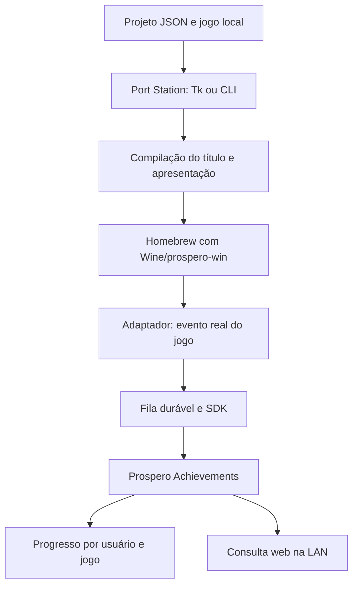

# Arquitetura e novos adaptadores

Este documento é para quem quer integrar eventos de outro jogo. Para configurar renderer, argumentos, controles e apresentação, use [Novo jogo](NEW_GAME.md).

## Componentes



`port_station/` contém a implementação Python: modelo de projeto, interface, CLI, geradores, tratamento de recursos e build. Não há um pacote Python de fachada separado.

O launcher prepara o prefixo e inicia o jogo. Um trabalhador do adaptador cuida de I/O e rede fora do loop de renderização. O jogo informa catálogo, ícones e eventos; o servidor persiste o estado e calcula a platina.

## Escolher o ponto de integração

Procure uma chamada que represente a condição já cumprida: a API de conquistas da engine, uma rotina própria de conclusão ou um evento de gameplay. Enviar um nome ao backend sem ligar essa chamada à condição real não implementa a conquista.

O adaptador `nwjs-steam` já envolve duas APIs JavaScript conhecidas. Para uma API diferente, implemente um adaptador que encaminhe os eventos ao SDK ou use `file-v1`. O adaptador `breath` é um exemplo de integração gerenciada específica; seu patcher não é um patcher Unity universal.

## SDK C/C++

O header e a biblioteca estão em `sdk/prospero-achievements/include/prospero_achievements.h` e `build/prospero-achievements/ps5/libprospero_achievements.a`.

Fluxo de um trabalhador nativo:

```c
#include <prospero_achievements.h>

PA_SDK sdk;
int rc = pa_sdk_init(&sdk, "/data/meu-port/achievement-outbox",
                     "meu.jogo", "0000002a", PA_SDK_DEFAULT_PORT);
/* Verifique rc. Use a ID do usuário local ativo, não a constante de exemplo. */

char hash[65];
/* pa_sdk_asset(&sdk, png_bytes, png_size, hash); */
/* pa_sdk_catalog(&sdk, catalog_json, catalog_size); */

/* Somente depois que a condição real acontecer: */
pa_sdk_unlock(&sdk, "FIRST_WIN", "install001-session001-event0001");

/* Periodicamente, no trabalhador, com intervalo/backoff: */
pa_sdk_pump(&sdk);
```

O exemplo mostra a sequência; as imagens e o JSON devem ser fornecidos antes dos eventos. Todos os retornos precisam ser tratados. O ID de evento deve ser único e persistir durante reenvios. Enfileirar significa gravar localmente; a confirmação chega quando o backend aceita o evento.

O callback de `pa_sdk_pump_with_callback` identifica desbloqueios novos aceitos, permitindo ao port apresentar um popup sem repetir avisos por reenvio.

## Ponte por arquivos

`file-v1` permite que um código executado dentro do Wine publique eventos para o trabalhador nativo. O contexto identifica jogo e usuário; a ponte cria um stream por usuário. Há implementações em `sdk/prospero-achievements/bridge/`.

Para JavaScript/Node, `prospero_file_bridge.js` oferece `create`, `markReady`, `unlock` e `flush`. O contexto precisa estar disponível antes de criar o cliente. O jogo fornece `gameId`, `achievementIds` e `contextFile`; chama `unlock` na condição real e repete `flush` após uma falha de escrita. Para outro ambiente, siga o [contrato da ponte](../sdk/prospero-achievements/bridge/README.md).

Leia também o [SDK](../sdk/prospero-achievements/README.md) e o [protocolo HTTP](../sdk/prospero-achievements/docs/PROTOCOL.md) para limites de payload, catálogo, IDs, eventos e persistência.

## Compatibilidade de dados

IDs de jogo e conquistas devem permanecer estáveis entre atualizações. Mudanças apenas nos nomes ou imagens usam uma revisão maior do catálogo. Mudanças de condição precisam de uma estratégia de migração.

O pacote Python é `port_station`. Alguns nomes do protocolo, arquivos de ponte e caminhos no console mantêm a forma histórica para preservar instalações existentes; eles não exigem um segundo pacote Python.
