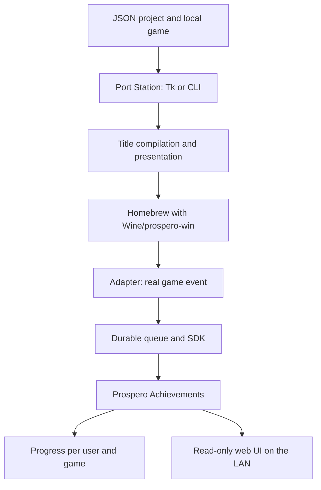

# Architecture and new adapters

[Documentation](INDEX.md) · [Home](../../README.md)

This guide is for integrating another game's events. For renderers, arguments,
controls and presentation, see [configure a new game](NEW_GAME.md).

## Components



`port_station/` contains the Python implementation: project model, UI, CLI,
generators, resources and build pipeline. There is no separate facade package.

The launcher prepares the prefix and starts the game. An adapter worker handles
I/O and networking outside the rendering loop. The game supplies its catalog,
icons and events; the server persists state and calculates completion.

## Choose an integration point

Find a call that represents a condition already met: the engine achievement
API, a game completion routine or a gameplay event. Sending a name to the
backend without connecting it to the actual condition does not implement
an achievement.

`nwjs-steam` already wraps two known JavaScript APIs. For another API, implement
an adapter forwarding events to the SDK or use `file-v1`. The `breath` adapter
is a specific managed integration, not a universal Unity patcher.

## C/C++ SDK

The header and library are at
`sdk/prospero-achievements/include/prospero_achievements.h` and
`build/prospero-achievements/ps5/libprospero_achievements.a`.

Native worker flow:

```c
#include <prospero_achievements.h>

PA_SDK sdk;
int rc = pa_sdk_init(&sdk, "/data/my-port/achievement-outbox",
                     "my.game", "0000002a", PA_SDK_DEFAULT_PORT);
/* Check rc. Use the active local user's ID, not the example constant. */

char hash[65];
/* pa_sdk_asset(&sdk, png_bytes, png_size, hash); */
/* pa_sdk_catalog(&sdk, catalog_json, catalog_size); */

/* Only after the actual condition occurs: */
pa_sdk_unlock(&sdk, "FIRST_WIN", "install001-session001-event0001");

/* Periodically, on the worker, with an interval/backoff: */
pa_sdk_pump(&sdk);
```

This shows the sequence; supply images and catalog JSON before events. Handle
every return value. Event IDs must be unique and remain stable across retries.
Enqueuing writes locally; confirmation arrives when the backend accepts the event.

`pa_sdk_pump_with_callback` identifies newly accepted unlocks so the port can
show a popup without repeating notifications on replay.

## File bridge

`file-v1` lets code running inside Wine publish events for the native worker.
The context identifies the game/user, and the bridge creates a per-user stream.
Implementations are in `sdk/prospero-achievements/bridge/`.

For JavaScript/Node, `prospero_file_bridge.js` provides `create`, `markReady`,
`unlock` and `flush`. The context must exist before creating the client. The
game provides `gameId`, `achievementIds` and `contextFile`, calls `unlock` at
the real award condition, and retries `flush` after a write failure. For other
environments, follow the [file bridge contract](../../sdk/prospero-achievements/bridge/README.md).

See the [SDK reference](SDK.md) and [HTTP protocol](PROTOCOL.md) for payload,
catalog, ID, event and persistence limits.

## Data compatibility

Keep game and achievement IDs stable across updates. Changes limited to names
or images use a higher catalog revision. Condition changes need a migration strategy.

The Python package is `port_station`. Some protocol identifiers, bridge files
and console paths keep historical names to preserve existing installations;
they do not require a second Python package.
